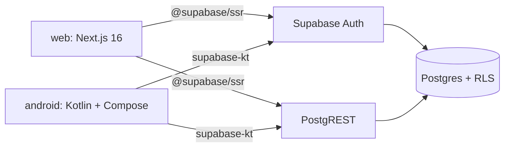

# Architecture

Web and Android are independent clients of the same Supabase project. There is no custom backend; Postgres with Row Level Security is the authorization layer. Decisions: [ADR index](adr/README.md).

## Data model

Defined in `supabase/migrations/` (source of truth).

- `transactions`: `id`, `user_id` (-> `auth.users`, cascade), `type` (`income`|`expense`), `amount` numeric(12,2) > 0, `category` (non-blank), `occurred_at`, `note`, `created_at`, `updated_at`. Index on `(user_id, occurred_at desc)`.
- `saving_goals`: `id`, `user_id`, `name`, `target_amount` > 0, `current_amount` >= 0, `period` (`monthly`|`yearly`), `deadline`, timestamps.
- `set_updated_at()` trigger keeps `updated_at` current (search_path pinned).
- RLS enabled on both tables; select/insert/update/delete policies require `(select auth.uid()) = user_id`.

Mirrors: `packages/shared/src/index.ts` (TS) and `android/app/src/main/java/com/moni/app/data/` (Kotlin).

## Request flow

Web:
1. Browser requests a page; `web/src/proxy.ts` refreshes the session cookie and redirects to `/login` if signed out.
2. Server components create a client (`web/src/lib/supabase/server.ts`), call `getUser()` and query PostgREST with the user's JWT.
3. Postgres applies RLS, so only the user's rows are returned. Mutations go through server actions.

Android:
1. `LoginScreen` signs in via supabase-kt; the session is held by the client.
2. `TransactionRepository` queries PostgREST with the JWT; `MoniViewModel` exposes state to Compose UI.
3. Same RLS rules apply.

## Environments

- Local: `supabase start` (API 54321, Studio 54323); Android uses `supabase.url=http://127.0.0.1:54321` plus `adb reverse tcp:54321 tcp:54321` (works on a USB phone and on the emulator).
- Production: web on Vercel (root dir `web`), DB on Supabase Cloud (`supabase link`, `supabase db push`), Android APK built with Gradle.
