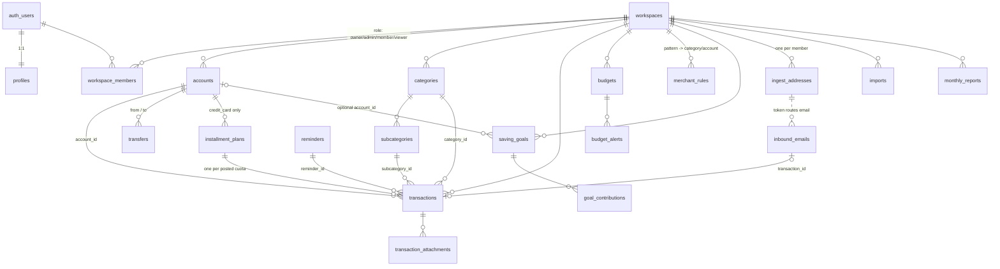

# Database

Supabase Postgres 17. The SQL in `supabase/migrations/` is the source of truth and the contract between web and Android. Decision record: [ADR-0007](adr/0007-merged-data-model.md). Generated TS types: `packages/shared/src/database.types.ts`.

## Migrations

| Version | What |
|---|---|
| `20260426171019_init_finance_tables` | Original per-user `transactions` and `saving_goals` |
| `20261122120000_harden_rls_and_functions` | `search_path` on `set_updated_at`, wrapped `auth.uid()` |
| `20261122130000_cloud_baseline` | Schema created on the cloud outside the repo (workspaces, accounts, budgets...). Marked applied on the remote with `migration repair`; it only runs locally |
| `20261123110000_account_type_values` | `account_type` enum mapped to Moni's account kinds |
| `20261123120000_merge_planning_and_capture` | Merge: workspace ownership everywhere, cards, transfers, installments, merchant rules, recurring reminders, capture metadata, email ingest, views, new RLS |

Tests: `supabase test db` (pgTAP, `supabase/tests/database/`). Lint: `supabase db lint --level warning`, `supabase db advisors`.

## Data model

| Table | Purpose / key columns |
|---|---|
| `workspaces`, `workspace_members` | Owner of all financial data. Each user gets a personal workspace on signup. Members have a role; `viewer` is read-only |
| `profiles` | `email`, `full_name`, `currency` (PEN) |
| `accounts` | `type` (`account_type`: yape, cash, savings, credit_card, debit, wallet, investment, other), `opening_balance`, `institution`, `last4`, `color`, `archived`. Cards also have `credit_limit`, `closing_day`, `due_day` (required on cards, forbidden elsewhere) |
| `categories` | `kind` (income/expense), `icon` (Lucide key), `color`, `archived`. Unique name per workspace |
| `subcategories` | Children of a category |
| `transactions` | `type`, `amount`, `occurred_at`, `account_id`, `category_id`, `subcategory_id`, `merchant`, `note`, `user_id` (author). Capture: `source`, `status`, `external_ref`, `raw_input`, `ai_confidence`. Links: `installment_plan_id` + `installment_number`, `reminder_id` |
| `transfers` | Between two accounts of the workspace. Not income or expense. Same capture fields |
| `installment_plans` | Compra en cuotas on a credit card: `total_amount`, `installments`, `installment_amount`, `interest_rate` (TEA, informational), `purchased_on`, `first_charge_on` |
| `reminders` | One-off reminders and recurring items. `kind` payable (expense) / receivable (income), `title`, `amount`, `due_date`, `frequency` (null = one-off; weekly/monthly/yearly), `remind_days_before`, `account_id`, `category_id`, `is_done` (finished or cancelled) |
| `budgets` | `scope` global / category / subcategory, `limit_amount`, `month` (null = standing monthly budget; first day of a month = override for that month) |
| `budget_alerts` | Log of `warning_80` / `exceeded_100` alerts (not written automatically yet) |
| `merchant_rules` | `pattern` (case-insensitive substring of `merchant`) -> `category_id` / `subcategory_id` / `account_id`, `priority` |
| `saving_goals`, `goal_contributions` | Goals (optional `account_id`); contributions keep `current_amount` in sync via trigger |
| `ingest_addresses` | Secret forwarding token per member and workspace: `<token>@alertas.<domain>` |
| `inbound_emails` | Log of forwarded emails, `parse_status`, `parser`, `transaction_id`. Written only by the service role |
| `imports`, `transaction_attachments`, `monthly_reports` | Kept from the cloud schema for statement imports, receipts and reports. No storage buckets exist yet |

Views (all `security_invoker = true`, so the caller's RLS applies; not readable by `anon`):

- `account_balances`: `balance` per account (confirmed transactions and transfers only). Cards: `card_debt`, `pending_installments` (cuotas not yet charged), `available_credit = credit_limit - card_debt - pending_installments`, `closing_day`, `due_day`.
- `installment_plan_status`: `installments_posted`, `installments_remaining`, `amount_remaining`, `next_charge_on`.
- `budget_progress`: one row per effective budget for the current month in America/Lima: `limit_amount`, `spent`, `remaining`, `percent_used`, `is_standing`.

RPCs: `ensure_personal_workspace()` returns (and creates if missing) the caller's workspace; `rotate_ingest_token(p_workspace_id default null)` issues a new forwarding token.

## Ownership and RLS

- Every financial row has `workspace_id NOT NULL`. It defaults to `private.current_workspace_id()` (the caller's oldest membership), so single-workspace clients can omit it.
- Author columns (`user_id`, `uploaded_by`) default to `auth.uid()`. They record who created the row; they do not grant access. Inserts require author = caller.
- Policies, identical on every workspace table: read when `workspace_id in (select private.my_workspace_ids())`, write when `workspace_id in (select private.my_writable_workspace_ids())` (any role except `viewer`). The helpers are `stable security definer` and run once per statement.
- Child rows reference parents through composite `(id, workspace_id)` foreign keys. A guessed UUID from another workspace fails with a foreign key error (PostgREST 409). A subcategory must also belong to the row's category.
- `ingest_addresses` and `inbound_emails`: each member sees only their own rows. Users cannot insert or update them; triggers create them and the Edge Function writes emails with the service role.
- Signup trigger (`on_auth_user_created_create_finance_workspace`): profile + workspace. The workspace trigger adds the owner membership and seeds 17 categories and an `Efectivo` cash account. The membership trigger creates the ingest address.

## Money rules

- Currency is PEN only: `numeric(12,2)`, `currency = 'PEN'` checks on workspaces, profiles, accounts, transactions and saving goals.
- Only `status = 'confirmed'` rows count in balances and budgets. `pending` is the "por revisar" inbox; `ignored` is kept for dedupe but never counted.
- Transfers move money between accounts and never count as income or expense. A card payment is a transfer into the card. A cash withdrawal is a transfer from a bank account to cash.
- Card sign convention: `opening_balance` and `card_debt` are positive when money is owed. An expense on the card adds to the debt; income on the card (refund) and transfers in (payments) reduce it. `balance` is `-card_debt`.
- Budgets count confirmed expenses whose `occurred_at` falls in the current America/Lima month.

## Installments

- **Only the monthly cuota counts** toward spending and budgets, never the full purchase price.
- Creating a plan posts every cuota already due. A pg_cron job (`post-due-installments`, 05:05 UTC = 00:05 Lima) posts new ones daily. Each cuota becomes an `expense` transaction on the card with `source = 'installment'`, `occurred_at` = charge date 12:00 Lima, note `"<description> (cuota n/N)"`, `external_ref = 'installment:<plan_id>:<n>'`. The dedupe index makes posting idempotent.
- Remaining cuotas (`installment_amount * remaining`) block the card's available credit.
- Deleting a posted cuota makes the job post it again. To skip one, set its `status = 'ignored'`. Deleting the plan deletes its cuotas.
- If a captured transaction for the full purchase exists (email or notification), mark it `ignored` when the user turns it into a plan.

## Capture pipeline

1. A source (Android notification listener, forwarded email, statement import, AI) produces a movement with `source`, `external_ref` (stable id from the source, such as the Yape operation number or email Message-ID), `merchant` and `raw_input`, usually with `status = 'pending'`.
2. Insert into `transactions` (or `transfers`). The unique index `(workspace_id, source, external_ref)` rejects duplicates (PostgREST 409). Treat 409 as "already captured".
3. Before insert, `merchant_rules` fill a missing category and account from the best-matching pattern (highest `priority`, then longest pattern; category kind must match the transaction type).
4. The user confirms, edits or ignores it from the inbox.
5. Email: Cloudflare Email Routing -> Worker -> Edge Function (service role). It looks up `ingest_addresses.token` from the recipient, inserts `inbound_emails` (unique per user and `message_id`), parses it and links `transaction_id`, or sets `parse_status` to `unrecognized` / `duplicate` / `error`.

Cross-source dedupe (the same payment from Wallet, the bank app and email, ±10 min and same amount) is application logic and is not enforced in the database.

## Function placement and the revoke crash {#gotcha}

On this Supabase build (Postgres 17.6), **calling a function whose EXECUTE privilege was revoked segfaults the backend and puts the whole database into recovery.** Never `revoke execute` on a function. Instead:

- `private` schema: RLS helpers (`is_workspace_member`, `is_workspace_admin`, `my_workspace_ids`, `my_writable_workspace_ids`, `current_workspace_id`) and the goal trigger. USAGE is granted to `authenticated` and `service_role` because policies and column defaults run as the caller. Not exposed by PostgREST.
- `internal` schema: triggers, seeding and jobs (`handle_new_user`, `seed_workspace_defaults`, `post_due_installments`, `apply_merchant_rules`...). No USAGE for `anon`, `authenticated` or `service_role`, so a direct call fails safely with `permission denied for schema internal`. Trigger and cron execution is unaffected.
- `public` RPCs (`ensure_personal_workspace`, `rotate_ingest_token`) stay executable by everyone and reject anonymous callers themselves. The Supabase advisor flags them as "security definer executable by anon". That is accepted: revoking would trigger the crash.

Table and view privileges can be revoked normally (e.g. `inbound_emails`, views for `anon`).
